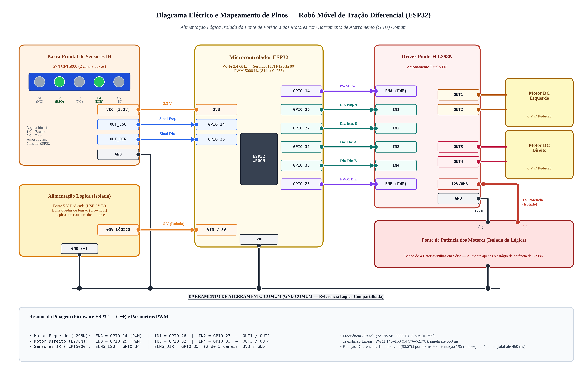

# Controle Sensoriomotor com Grandes Modelos de Linguagem

Repositório oficial do Trabalho de Conclusão de Curso (Ciência da Computação — Universidade Federal da Fronteira Sul, UFFS, 2026).

- **Autora:** Paula Frison Padilha
- **Orientador:** Prof. Dr. Luciano Lores Caimi
- **Base metodológica:** Adaptado do *framework* de Refinamento Iterativo de Políticas de Jônata Tyska Carvalho e Stefano Nolfi ([arXiv:2506.04867](https://arxiv.org/abs/2506.04867) | [`jtyska/llm-robotics-article`](https://github.com/jtyska/llm-robotics-article)).

## Visão Geral

Este projeto transpõe a arquitetura de controle sensoriomotor direto via Grandes Modelos de Linguagem (LLMs) — originalmente validada em simuladores virtuais — para um robô móvel físico de tração diferencial baseado em ESP32. Por meio de uma interface padronizada (`EnvironmentPhysical`) desacoplada em dois ciclos (Ciclo Deliberativo entre tentativas no computador local e Ciclo Reativo em malha fechada durante a execução), a LLM sintetiza e refina funções de controle em Python diretamente a partir das leituras dos sensores infravermelhos e do sinal de recompensa, sem uso de primitivas motoras pré-programadas.

## Estrutura do Repositório

```text
.
├── code/
│   ├── environments/
│   │   ├── Environment.py                     # Interface abstrata de ambiente
│   │   ├── EnvironmentFactory.py              # Fábrica de ambientes (fisico / gym)
│   │   ├── EnvironmentGym.py                  # Conector original para simulação
│   │   └── EnvironmentPhysical.py             # Camada física HTTP/JSON para o ESP32
│   ├── experiment/
│   │   ├── Experiment.py                      # Loop base de execução de tentativas
│   │   └── ExperimentSeries.py                # Orquestração a partir de config.json
│   ├── llms/
│   │   ├── Llm.py                             # Interface abstrata de LLM
│   │   ├── LlmModelFactory.py                 # Fábrica de conectores (ollama / gemini)
│   │   ├── LlmOllama.py                       # Conector local via servidor Ollama
│   │   └── LlmGemini.py                       # Conector alternativo via API em nuvem
│   ├── user_experiments/
│   │   └── line_follower/
│   │       ├── config.json                    # Parâmetros das baterias experimentais
│   │       └── CreateStrategyCompareUpdate.py # Prompts 1–4 e refinamento iterativo
│   ├── utils/                                 # Gerenciamento de configuração, logs e CSVs
│   ├── run_experiments.py                     # Script principal de execução
│   ├── setup_requirements.py                  # Instalador de dependências
│   └── setup_requirements.txt                 # Lista de dependências Python
├── firmware/
│   └── esp32_line_follower.ino                # Firmware C++ do servidor HTTP no ESP32
├── results/
│   └── resultado01.csv ... resultado10.csv    # Registros das 10 baterias (40 tentativas)
└── esquema_eletrico_robo.png                  # Diagrama elétrico e mapeamento de pinos
```

## Diagrama Elétrico do Robô



## Como Reproduzir os Experimentos

### 1. Hardware e Firmware (ESP32)
1. Monte o robô de tração diferencial conforme `esquema_eletrico_robo.png` (mantendo a alimentação lógica do ESP32 isolada da alimentação de potência da ponte-H L298N, com aterramento comum).
2. Abra `firmware/esp32_line_follower.ino` na Arduino IDE, substitua `YOUR_WIFI_SSID` e `YOUR_WIFI_PASSWORD` pelas credenciais da sua rede Wi-Fi 2,4 GHz e grave no ESP32.
3. Abra o Monitor Serial (`115200 baud`) para consultar o IP local atribuído ao ESP32 e configure o endereço em `code/environments/EnvironmentPhysical.py` (ou via variável de ambiente `ROBO_IP`).

### 2. Servidor Local de LLM (Ollama)
Instale o [Ollama](https://ollama.com/), baixe o modelo utilizado nas baterias experimentais e inicie o servidor local:

```bash
ollama pull llama3
ollama serve
```

### 3. Ambiente Python e Execução
Crie um ambiente virtual, instale as dependências e execute o experimento do seguidor de linha:

```bash
python3 -m venv venv
source venv/bin/activate
cd code
python3 setup_requirements.py
python3 run_experiments.py --name line_follower
```

Para sobrescrever resultados anteriores de testes locais, adicione a flag `--delete_previous_data`.

## Parâmetros Experimentais e Registros

Os arquivos em `results/` contêm os registros passo a passo (observação, ação, recompensa instantânea, recompensa acumulada e metadados de configuração) das 10 baterias físicas executadas com:

- **Modelo:** `llama3` (8B parâmetros, via Ollama local)
- **Temperatura:** `0.7` | **Semente:** `42`
- **Tentativas por bateria:** `4` | **Horizonte máximo:** `20 passos` (~60 cm) | **Memória (`steps_memory`):** `15 passos`

| Bateria | Arquivo | Lote Experimental | Passos Méd. | Rec. 1ª | Rec. Máx. | Rec. Méd. |
| :--- | :--- | :--- | :---: | :---: | :---: | :---: |
| Bateria 1 | `results/resultado01.csv` | Lote 1 (Recompensa) | 20,00 | 12,80 | 12,80 | 9,25 |
| Bateria 2 | `results/resultado02.csv` | Lote 1 (Recompensa) | 20,00 | 11,00 | 13,80 | 10,80 |
| Bateria 3 | `results/resultado03.csv` | Lote 1 (Recompensa) | 20,00 | 12,00 | 16,40 | 10,10 |
| Bateria 4 | `results/resultado04.csv` | Lote 1 (Recompensa) | 16,25 | 18,20 | 18,20 | 11,15 |
| Bateria 5 | `results/resultado05.csv` | Lote 1 (Recompensa) | 20,00 | 13,60 | 16,80 | 15,00 |
| Bateria 6 | `results/resultado06.csv` | Lote 2 (Simetria PWM) | 11,25 | 4,40 | 10,80 | 5,25 |
| Bateria 7 | `results/resultado07.csv` | Lote 2 (Simetria PWM) | 18,50 | 6,40 | 15,20 | 12,60 |
| Bateria 8 | `results/resultado08.csv` | Lote 2 (Simetria PWM) | 14,00 | 2,20 | 18,40 | 9,40 |
| Bateria 9 | `results/resultado09.csv` | Lote 2 (Simetria PWM) | 15,00 | 6,40 | 14,40 | 9,20 |
| Bateria 10 | `results/resultado10.csv` | Lote 2 (Simetria PWM) | 20,00 | 20,00 | 20,00 | 15,00 |

## Créditos e Licença

A arquitetura base do código Python deriva do repositório [`jtyska/llm-robotics-article`](https://github.com/jtyska/llm-robotics-article) (Carvalho e Nolfi, 2026), licenciado sob MIT com restrição de uso não comercial (uso comercial exige autorização prévia dos autores originais). Os demais materiais suplementares (diagramas e registros experimentais) seguem a licença [CC BY-NC 4.0](https://creativecommons.org/licenses/by-nc/4.0/).
